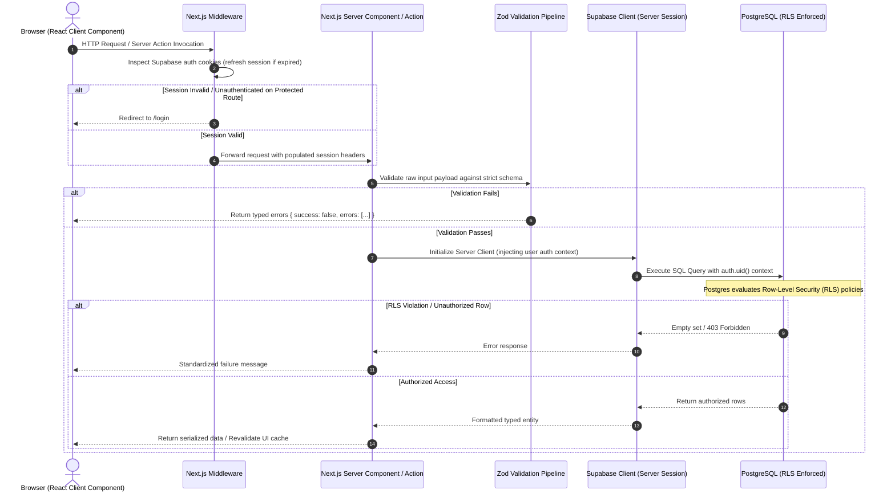

# Architecture Specification & System Blueprint

## 1. Technology Stack Specification

| Tier | Technology | Specification / Version | Purpose & Rationale |
| :--- | :--- | :--- | :--- |
| **Framework** | Next.js (App Router) | `14.2.x` (or latest LTS) | React Server Components (RSC), Streaming SSR, Route Handlers, and Server Actions for unified backend logic. |
| **Language** | TypeScript | `^5.5.x` | Strict mode enabled (`strict: true`, `noImplicitAny: true`, `exactOptionalPropertyTypes: true`). |
| **Runtime** | Node.js | `>=20.x LTS` | Predictable server execution environment. |
| **Styling** | Tailwind CSS | `^3.4.x` | Tokenized utility-first styling with `@tailwindcss/typography` and `tailwind-merge`. |
| **UI Primitives** | Radix UI / shadcn/ui | Latest | Headless, accessible primitives with zero runtime style pollution. |
| **Database** | PostgreSQL | `v15+` | Relational data persistence managed through Supabase with native Row-Level Security (RLS). |
| **Auth & Storage** | Supabase | `@supabase/ssr`, `@supabase/supabase-js` | Session-cookie managed JWT authentication, file storage with granular bucket policies. |
| **Schema Validation** | Zod | `^3.23.x` | Server-side and client-side request payload, form, and environment variable schema validation. |
| **State & Cache** | TanStack React Query / Server Cache | `^5.x` / Next `revalidateTag` | Client-side optimistic mutations and fine-grained server-side tag revalidation. |

---

## 2. End-to-End Request & Data Flow



---

## 3. Directory & Folder Structure

```
project-root/
├── app/                              # Next.js App Router directory
│   ├── (auth)/                       # Route group: Unauthenticated auth routes
│   │   ├── login/
│   │   │   └── page.tsx
│   │   ├── register/
│   │   │   └── page.tsx
│   │   └── layout.tsx
│   ├── (dashboard)/                  # Route group: Protected user portal
│   │   ├── dashboard/
│   │   │   ├── page.tsx
│   │   │   └── loading.tsx
│   │   ├── settings/
│   │   │   └── page.tsx
│   │   └── layout.tsx
│   ├── api/                          # Route handlers (Webhook endpoints & external integrations)
│   │   └── webhooks/
│   │       └── stripe/
│   │           └── route.ts
│   ├── error.tsx                     # Global route error boundary
│   ├── layout.tsx                    # Root HTML layout with providers & fonts
│   ├── not-found.tsx                 # 404 page
│   └── page.tsx                      # Public landing page
├── components/                       # UI components tree
│   ├── ui/                           # Reusable low-level design system primitives (Button, Modal, Input)
│   │   ├── button.tsx
│   │   ├── card.tsx
│   │   ├── dialog.tsx
│   │   └── input.tsx
│   ├── forms/                        # Domain-specific client form components
│   │   ├── login-form.tsx
│   │   └── profile-form.tsx
│   ├── layout/                       # Structural layout elements (Nav, Sidebar, Header, Footer)
│   │   ├── navbar.tsx
│   │   └── sidebar.tsx
│   └── shared/                       # Shared composite widgets (UserAvatar, EmptyState, DataTable)
│       ├── empty-state.tsx
│       └── skeleton-card.tsx
├── lib/                              # Core utilities and library adapters
│   ├── constants/                    # Application-wide constants & enums
│   │   └── navigation.ts
│   ├── supabase/                     # Supabase client instantiation
│   │   ├── client.ts                 # Browser client (createBrowserClient)
│   │   ├── server.ts                 # Server action & RSC client (createServerClient)
│   │   └── middleware.ts             # Edge cookie refresh adapter
│   ├── utils.ts                      # General helper functions (cn, formatters)
│   └── validations/                  # Zod schema definitions
│       ├── auth.ts
│       └── profile.ts
├── server/                           # Backend application layer
│   ├── actions/                      # Next.js Server Actions ("use server")
│   │   ├── auth.actions.ts
│   │   └── profile.actions.ts
│   └── services/                     # Business logic and external service adapters
│       └── email.service.ts
├── types/                            # Global TypeScript definitions & database schemas
│   ├── database.types.ts             # Auto-generated Supabase PostgreSQL types
│   └── index.ts                      # Shared domain interfaces
├── middleware.ts                     # Next.js Edge routing and session interceptor
├── .env.example                      # Documented environment variables template
├── .eslintrc.json                    # Strict linting configuration
├── tailwind.config.ts                # Tailwind design token configuration
├── tsconfig.json                     # Strict TypeScript compiler options
└── package.json
```

---

## 4. Strict Architectural Governance Rules

1. **Rule 1: UI Components Never Contain Database Logic**
   - React components (both Server and Client) MUST NOT invoke direct SQL queries, raw database drivers, or administrative bypass clients.
   - All data transactions must route through `server/actions/` or dedicated server modules with strict DTO output contracts.

2. **Rule 2: Verify Authorization & Session State on the Server**
   - Client-side route guards (e.g., hiding a button or redirecting via `useEffect`) are cosmetic ONLY.
   - Every Server Action, Route Handler, and Server Component MUST authenticate the active user session via `createClient().auth.getUser()` before executing logic or rendering sensitive markup. Never trust `auth.getSession()` on the server for security decisions.

3. **Rule 3: Keep Data Fetching in Server Components & Server Actions**
   - Client components MUST NOT use raw `useEffect` + `fetch()` to query internal databases.
   - Default to React Server Components (RSC) for initial page renders and data fetching. Use Server Actions for data mutations and TanStack Query / React cache tags for mutations and revalidation.

4. **Rule 4: Separation of Environment Contexts**
   - No secret keys (e.g., `SUPABASE_SERVICE_ROLE_KEY`, `DATABASE_URL`, Stripe private keys) may ever be prefixed with `NEXT_PUBLIC_`.
   - Any client-side reference to a private environment variable fails build-time validation.
